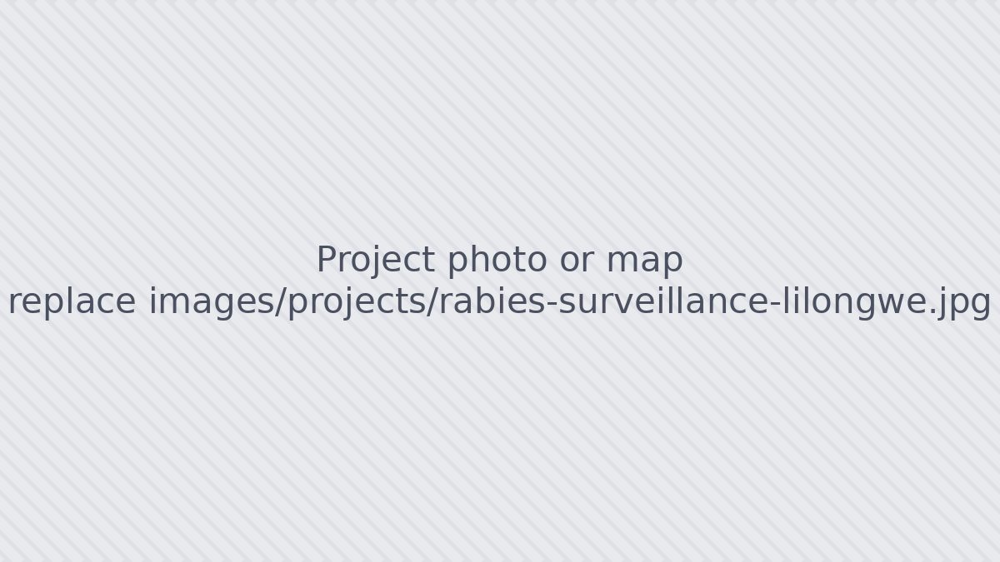

::: pm-status-line
[Published]{} [Surveillance evaluation]{.focus} [Health systems]{.focus}
:::

{fig-alt="Placeholder for a surveillance photo or figure from Lilongwe"}

## Overview

A comparative evaluation of participatory and passive rabies surveillance in urban Lilongwe, focusing on surveillance attrition, case ascertainment and what these mean for public health decision-making.

## Research questions

- [Research question 1]
- [Research question 2]

## Approach

[Summarise the study design and analysis in two or three sentences.]

## Key findings

[Summarise two or three key findings from the published paper.]

## Publication

**Mastala PI**, Kalonde PK, Chiweta E, et al. Where are rabies cases lost along the surveillance pathway? A comparative evaluation of participatory and passive rabies surveillance in urban Lilongwe, Malawi. *BMC Public Health*. 2026. [doi:10.1186/s12889-026-30160-y](https://doi.org/10.1186/s12889-026-30160-y)

## Collaborators

[List collaborating institutions.]
